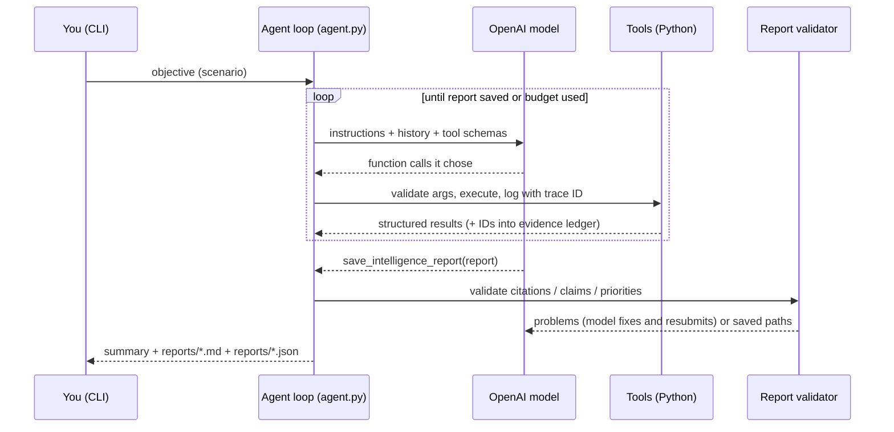

# Architecture

This project separates **what the agent should know**, **how it gathers evidence**,
**what Python computes**, and **what the model decides**. Each layer can be read,
tested, and changed on its own.

```
agent/                      How the agent behaves
  system-prompt.md          Role, rules, uncertainty, prompt-injection handling (loaded every run)
  scope.md                  Authority limits and run budget (loaded every run)
  workflows/*.md            Detailed procedures, read on demand via read_business_document
knowledge-base/*.md         What the business is: company, products, customers, priorities, evidence standards
competitors/                Who we watch: watchlist.json (variant → Northstar product mapping) + profiles
data/                       Evidence: product-page HTML, normalized snapshots, reviews, news, scenarios
src/competitive_intelligence/
  tools/                    Model-callable functions (read-only, plus one report writer)
  analysis/                 Deterministic logic: change detection, sentiment aggregation, priority rubric
  integrations/             Data sources: mock fixtures, HTML parser, optional live fetcher, review exports
  agent.py                  The tool-calling loop
  reports.py                Report validation, enrichment with computed facts, Markdown rendering
  scan.py / briefing.py     No-LLM monitoring scan and rule-based offline briefing
  evaluation.py             Deterministic and agent evaluations
reports/                    Generated briefs (git-ignored except reports/examples/)
evals/                      Evaluation cases and runner
claude-skill/               The same workflow packaged as a Claude Skill
```

## Why each separation exists

| Layer | Why it is separate |
|---|---|
| **System prompt** | Short, always loaded. Holds rules that apply to every run (evidence, sample sizes, no motives, untrusted content). Long prompts get ignored; procedures live elsewhere. |
| **Workflows** | Detailed "how to" steps for change detection, sentiment, prioritization, and briefing. The model reads only the ones it needs, which keeps context small and makes them easy to edit. |
| **Business context** | The agent's judgment depends on *our* products and priorities. Changing `competitive-priorities.md` changes what the agent considers important — no code changes. |
| **Competitor profiles + watchlist** | The watchlist is structured data (used by code for comparability and relevance). Profiles are prose (used by the model, including what we *don't* know). |
| **Retrieval tools** | Each tool does one thing and returns a structured envelope (`ok` / `not_found` / `invalid_input` / `error`). Page and review text is wrapped in `untrusted_content`. Every returned ID is recorded in an **evidence ledger**. |
| **Historical snapshots** | Change detection needs at least two observations. Normalized JSON snapshots make comparisons exact and testable; the HTML fixtures prove the parser produces those records. |
| **Analysis (Python)** | Arithmetic, comparability, duplicate detection, counting, and the rubric are deterministic. The model never calculates percentages or counts reviews. |
| **Model (LLM)** | Decides what to investigate next, interprets messaging and reviews, weighs significance against business priorities, and writes recommendations. |
| **Reports** | The model submits judgments; `reports.py` validates them (citations must be in the ledger, no population claims, no asserted motives, no `high` for no-alert events) and inserts computed facts (prices, percentages, review counts, sample sizes, sources). |
| **Evaluations** | Deterministic checks guard the Python; agent checks grade structured output from real runs. They are kept apart because only the first kind is repeatable. |

## A run, step by step



## Tools vs reasoning

| Python (deterministic) | Model (judgment) |
|---|---|
| Parse HTML and JSON-LD; normalize fields | Decide which products and pairs to investigate |
| Check variant, currency, storefront, completeness | Decide whether to fetch the current page or read reviews |
| Compute price changes (Decimal, half-up rounding) | Interpret a headline change or a new feature |
| Detect feature/messaging/availability changes | Judge what themes in reviews mean for Northstar |
| Find duplicate reviews; count unique reviews per aspect | Weigh significance against priorities; final priority |
| Rubric baseline with factor reasons | Write recommendations and the brief |
| Validate and render the report | — |

Review **annotation** (which aspect, which sentiment) is done by an LLM with Structured
Outputs (`analysis/sentiment.py`), or by hand-labeled reference annotations in offline
mode. **Counting** those annotations is always Python.

## Guardrails in code (not just in the prompt)

- No tool can change prices, edit pages, publish, post, contact anyone, or send alerts.
  Calls to such names are blocked and logged (`guardrails.RESTRICTED_OPERATIONS`).
- The only write is `save_intelligence_report`, restricted to `reports/` via `storage.safe_child`.
- Document reading is allowlisted (`KnowledgeBase`); no arbitrary file paths.
- Run budgets: `CI_MAX_ITERATIONS` model turns and `CI_MAX_TOOL_CALLS` tool executions.
- Untrusted text is delimited and scanned for injection patterns; findings are reported.
